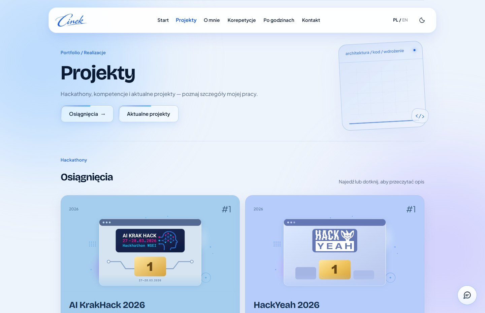
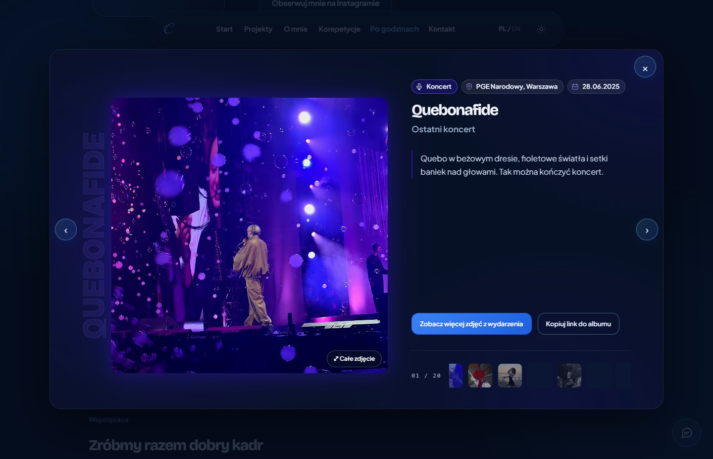

<div align="center">

<br>


# Kod. Kadry. Własna perspektywa.

**Portfolio Marcina Podymy**<br>
Projekty programistyczne, fotografia i matematyka — w jednym miejscu.

<br>

[](https://cinek477.github.io/portfolio/)
[](docs/README.md)

<sub>HTML · CSS · JavaScript · Node.js · SQLite</sub>

<br><br>

<a href="https://cinek477.github.io/portfolio/">
  <picture>
    <source media="(prefers-color-scheme: dark)" srcset="docs/images/home-dark.jpg">
    <source media="(prefers-color-scheme: light)" srcset="docs/images/home-light.jpg">
    
  </picture>
</a>

<sub>Podgląd dopasowuje się do jasnego lub ciemnego motywu Twojego GitHuba.</sub>

</div>

<br>

## Jedna strona, kilka stron mnie.

Studiuję informatykę na AGH. Tworzę projekty, uczę matematyki, a po godzinach fotografuję ludzi i koncerty. To portfolio łączy te rzeczy — od pomysłu i kodu po gotowe kadry.

<table>
<tr>
<td width="50%" valign="top">
<h3>Projekty, nie tylko linki.</h3>
<p>Realizacje i osiągnięcia z opisem problemu, rozwiązania i mojego wkładu. Technologie zebrane w kafelkach z ikonami.</p>
<a href="https://cinek477.github.io/portfolio/projekty/"></a>
<p><a href="https://cinek477.github.io/portfolio/projekty/"><strong>Poznaj projekty →</strong></a></p>
</td>
<td width="50%" valign="top">
<h3>Kadry z pierwszego rzędu.</h3>
<p>Koncerty, portrety, natura i miejsca. Albumy, własne kadry miniatur i podgląd z poświatą w kolorach fotografii.</p>
<a href="https://cinek477.github.io/portfolio/po-godzinach/"></a>
<p><a href="https://cinek477.github.io/portfolio/po-godzinach/"><strong>Wejdź do galerii →</strong></a></p>
</td>
</tr>
</table>

**A poza tym?** [Korepetycje z matematyki](https://cinek477.github.io/portfolio/korepetycje/), [kilka słów o mnie](https://cinek477.github.io/portfolio/o-mnie/) i [kontakt dopasowany do tematu](https://cinek477.github.io/portfolio/kontakt/).

<br>

## Prosta na zewnątrz. Własna od środka.

Nie korzystam z zewnętrznego CMS-a. Za publiczną stroną stoi **lokalny panel administratora**: edycja treści PL/EN, zdjęcia i albumy, szkice podstron, opinie, wiadomości oraz kopie bezpieczeństwa.

| Dla odwiedzających | Do zarządzania |
| :--- | :--- |
| Jasny i ciemny motyw | Własny panel z logowaniem |
| Polska i angielska wersja | Treści i ustawienia w SQLite |
| Układ na komputer i telefon | Kadrowanie zdjęć, okładki i albumy |
| Obsługa klawiatury i ograniczenie animacji | Szkice, kosz i kopie zapasowe |
| Strona statyczna na GitHub Pages | Automatyczny eksport publicznych danych |

**Bez frameworka frontendowego. Bez zależności npm. Z wbudowanym SQLite.**

<br>

## Architektura

| Warstwa | Rozwiązanie |
| :--- | :--- |
| **Frontend** | HTML, CSS i JavaScript — bez frameworka; PL/EN i dwa motywy |
| **Backend** | Lokalny serwer HTTP w Node.js 24+ |
| **Dane** | Wbudowany SQLite i publiczne eksporty treści |
| **Zarządzanie** | Własny panel z logowaniem, szkicami, koszem i kopiami |
| **Hosting** | Statyczna strona na GitHub Pages, publikowana przez GitHub Actions |

```text
Panel lokalny → SQLite → publiczne eksporty i zdjęcia
                                     ↓
                              commit i push
                                     ↓
                       GitHub Actions · kontrole i testy
                                     ↓
                               GitHub Pages
```

**Baza nie jest potrzebna odwiedzającym.** Publiczna strona korzysta z wyeksportowanych plików. Edycja, konto administratora i prywatne wiadomości pozostają na komputerze.

## Uruchomienie lokalne

Wymagany **Node.js 24+**. SQLite jest wbudowany — nie trzeba wykonywać `npm install`.

```sh
git clone https://github.com/Cinek477/portfolio.git
cd portfolio
npm start
```

| | Adres |
| :--- | :--- |
| Strona | [127.0.0.1:3000](http://127.0.0.1:3000/) |
| Panel administratora | [127.0.0.1:3000/admin](http://127.0.0.1:3000/admin) |

Konto administratora tworzysz przy pierwszym wejściu do panelu. Serwer nasłuchuje tylko lokalnie; zatrzymasz go przez **Ctrl+C**.

<details>
<summary><strong>Windows z lokalną kopią Node.js</strong></summary>

Jeżeli runtime znajduje się w `.local/`, uruchom projekt skryptem:

```powershell
powershell -ExecutionPolicy Bypass -File .\scripts\start-gallery.ps1
```

Po zmianach kodu serwera uruchom go ponownie.

</details>

## Kontrole i eksport

```sh
npm run check          # składnia, zasoby i odnośniki
npm test               # testy na odizolowanych danych
npm run pages:prepare  # eksport do dist/github-pages/
```

Testy automatyczne uzupełniają sprawdzanie wyglądu i obsługi na komputerze oraz telefonie.

<details>
<summary><strong>Co trafia do internetu?</strong></summary>

<br>

| Publiczne | Prywatne — poza Git |
| :--- | :--- |
| Kod strony, style i skrypty | Baza `data/gallery.sqlite` |
| Zdjęcia i miniatury | Konto administratora i wiadomości |
| Eksporty treści i ustawień | `.env`, tokeny i kopie bezpieczeństwa |

Zapis w panelu **nie publikuje strony samodzielnie**. Po commit i push na `main` workflow uruchamia kontrole, testy i publikację.

W wersji statycznej kreator kontaktu otwiera szkic w programie pocztowym. Panel zapisu i dane Spotify na żywo wymagają lokalnego backendu. Pod adresem panelu na GitHub Pages jest tylko informacja o edycji lokalnej.

Zdjęcia, style, skrypty i pliki danych otrzymują wersjonowane adresy, aby aktualizacje nie mieszały się ze starszymi plikami z pamięci przeglądarki.

**Uwaga:** ukrycie lub usunięcie wpisu zdjęcia nie usuwa jego pliku z repozytorium. Fotografie w `assets/` są publiczne.

[Instrukcja publikacji →](docs/GITHUB-PAGES.md)

</details>

<details>
<summary><strong>Mapa repozytorium</strong></summary>

```text
pages/          podstrony HTML
assets/         style, skrypty, zdjęcia i publiczne eksporty
components/     nawigacja i stopka
shared/         walidacja, renderowanie i treści domyślne
server/         moduły lokalnego backendu
scripts/        uruchamianie, kontrole i publikacja
tests/          testy automatyczne
docs/           dokumentacja i podglądy
server.cjs      punkt uruchomienia serwera
```

</details>

<br>

[Panel i zdjęcia](docs/LOCAL-GALLERY.md) · [Galeria i albumy](docs/funkcje/GALERIA-ALBUMY.md) · [Zasady wyglądu](docs/DESIGN.md) · [Cała dokumentacja](docs/README.md)

---

<div align="center">

**Marcin Podyma / Cinek**<br>
<sub>Od pierwszej linijki kodu do ostatniego kadru.</sub>

<br>

[portfolio](https://cinek477.github.io/portfolio/) · [kontakt](https://cinek477.github.io/portfolio/kontakt/)

</div>
