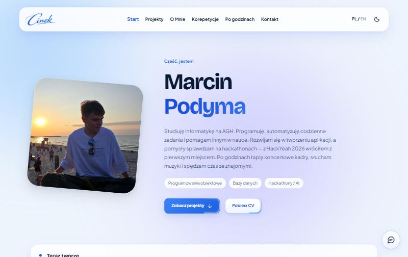
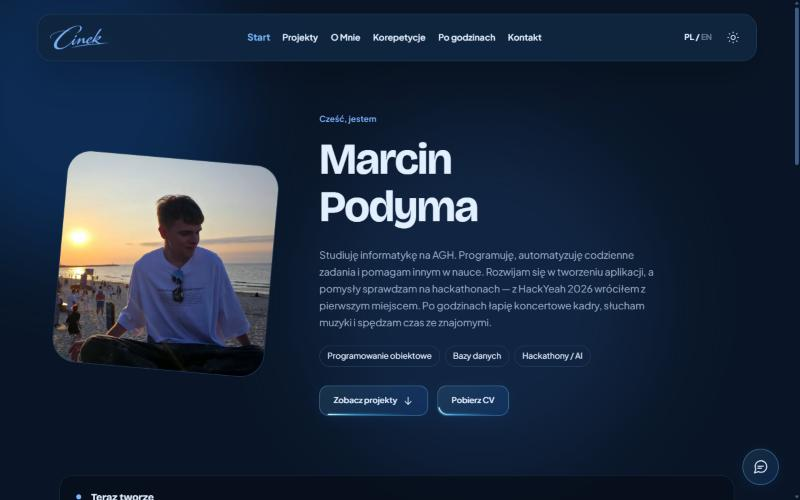

<div align="center">


# Marcin Podyma — portfolio

Projekty, fotografia, korepetycje i kreator kontaktu w jednym miejscu.<br>
Własny panel do zarządzania treścią PL/EN, zdjęciami, opiniami i wiadomościami.

[**Zobacz stronę →**](https://cinek477.github.io/portfolio/)


</div>

<table>
  <tr>
    <td></td>
    <td></td>
  </tr>
  <tr>
    <td align="center"><sub>Jasny motyw</sub></td>
    <td align="center"><sub>Ciemny motyw</sub></td>
  </tr>
</table>

## ✨ Funkcje

| | |
| --- | --- |
| 🧩 **Edycja treści** | Sekcje podstron, szkice, porównanie z opublikowaną wersją i kontrola przed publikacją. |
| 💻 **Projekty** | Projekty i osiągnięcia z osobnymi opisami realizacji. |
| 📸 **Galeria** | Filtry, albumy, okładki, kadr miniatur i udostępnianie. Podgląd w kwadracie, po kliknięciu całe zdjęcie z poświatą w jego kolorze. |
| 🎓 **Korepetycje** | Oferta, promocje, opinie z oceną i FAQ. |
| ✉️ **Kontakt** | Kreator dopasowany do tematu. Prywatna skrzynka ze statusami, notatkami, spamem i koszem. |
| 💾 **Kopie** | Ręczne i automatyczne przed większymi zmianami (pięć najnowszych automatycznych). |
| 🎧 **Spotify** | Opcjonalnie: bieżący utwór i najczęściej słuchane, bez odtwarzania muzyki. |

## 🚀 Uruchomienie lokalne

Wymagany **Node.js 24+**. Serwer używa wbudowanego SQLite, więc nie trzeba instalować pakietów npm.

```sh
npm start
```

Na Windows z lokalnym Node w `.local/`:

```powershell
powershell -ExecutionPolicy Bypass -File .\scripts\start-gallery.ps1
```

Strona: http://127.0.0.1:3000/ · Panel: http://127.0.0.1:3000/admin
Serwer nasłuchuje wyłącznie lokalnie. Zatrzymanie: <kbd>Ctrl</kbd>+<kbd>C</kbd>.

<details>
<summary><b>Adresy podstron</b></summary>

| Widok | Adres |
| --- | --- |
| Start | `/` |
| O mnie | `/o-mnie` |
| Projekty | `/projekty` |
| Korepetycje | `/korepetycje` |
| Po godzinach | `/po-godzinach` |
| Kontakt | `/kontakt` |
| Swoją Drogą | `/projekty/swoja-droga` |
| AI KrakHack | `/projekty/krakhack` |
| Album | `/album/IDENTYFIKATOR_ZDJECIA` |

Dawne adresy `.html` przekierowują na nowe; pliki źródłowe zachowują nazwy. Na innym hostingu obsługę nowych adresów trzeba skonfigurować osobno.

</details>

## ♿ Dostępność

- Link „Przejdź do treści” na każdej podstronie (pierwsze naciśnięcie <kbd>Tab</kbd>).
- Widoczny fokus klawiatury w nawigacji, przyciskach i polach formularza.
- Kontrast tekstu zgodny z WCAG AA w obu motywach.
- Atrybut `lang` przełączany razem z językiem PL/EN, opisy `alt` przy zdjęciach.
- Animacje ograniczone przy `prefers-reduced-motion`.

## 🔐 Panel i dane

Panel wymaga logowania; przy pierwszym uruchomieniu bez konta można je utworzyć. Zapis wymaga sesji administratora i sprawdzenia pochodzenia żądania.

- Lokalna baza: `data/gallery.sqlite`.
- **Prywatne** (ignorowane przez Git): dane, hasła, tokeny Spotify, `.env`, kopie bezpieczeństwa.
- **Publiczne**: eksporty `gallery-data.js`, `projects-data.js`, `home-data.js`, `pages-data.js` i zdjęcia.

Więcej: [dane, galeria i kopie](docs/LOCAL-GALLERY.md) · [wiadomości i poczta](docs/CONTACT-MESSAGES.md)

## ✅ Sprawdzanie

```sh
npm run check
npm test
```

Kontrole sprawdzają składnię, zasoby i backend na odizolowanych danych. Nie zastępują sprawdzenia wyglądu na prawdziwym telefonie.

| npm | bez npm |
| --- | --- |
| `npm start` | `node server.cjs` |
| `npm run check` | `node scripts/check-project.cjs` |
| `npm test` | `node --test --test-concurrency=1 tests/*.test.cjs` |
| `npm run pages:prepare` | `node scripts/prepare-pages.cjs` |

## 🌐 GitHub Pages

Wersja statyczna jest budowana przez GitHub Actions z gałęzi `main` (Settings → Pages → Source: **GitHub Actions**). Panel i backend zostają lokalnie, a kreator kontaktu otwiera szkic w programie pocztowym.

[Instrukcja GitHub Pages](docs/GITHUB-PAGES.md)

## 📁 Struktura

<details>
<summary><b>Foldery projektu</b></summary>

| Folder | Przeznaczenie |
| --- | --- |
| `pages/` | Źródła podstron HTML |
| `server/`, `server.cjs` | Moduły backendu i plik uruchamiający |
| `assets/` | Style, skrypty, zdjęcia i publiczne eksporty |
| `components/`, `shared/` | Wspólne elementy, walidacja i treści domyślne |
| `scripts/`, `tests/` | Uruchamianie i kontrole |
| `docs/` | Dokumentacja i zrzuty do README |
| `data/`, `backups/` | Prywatne dane i kopie bezpieczeństwa |
| `outputs/` | Checklista XLSX i dawne podglądy |
| `work/checklist/` | Źródła generatora checklisty |
| `.local/` | Lokalny Node, logi i narzędzia robocze |

</details>

📚 [Spis dokumentacji](docs/README.md) · [mapa folderów](docs/FOLDERY.md) · [zasady wyglądu](docs/DESIGN.md) · [pomysły](docs/POMYSLY.md)
