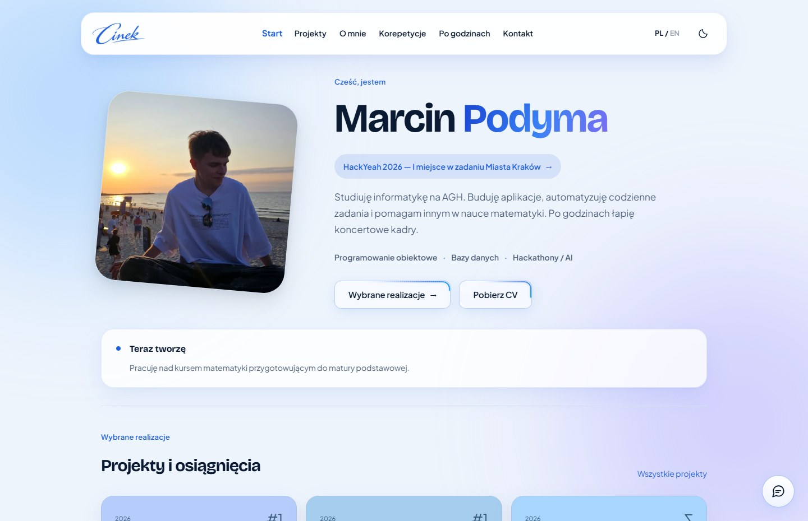
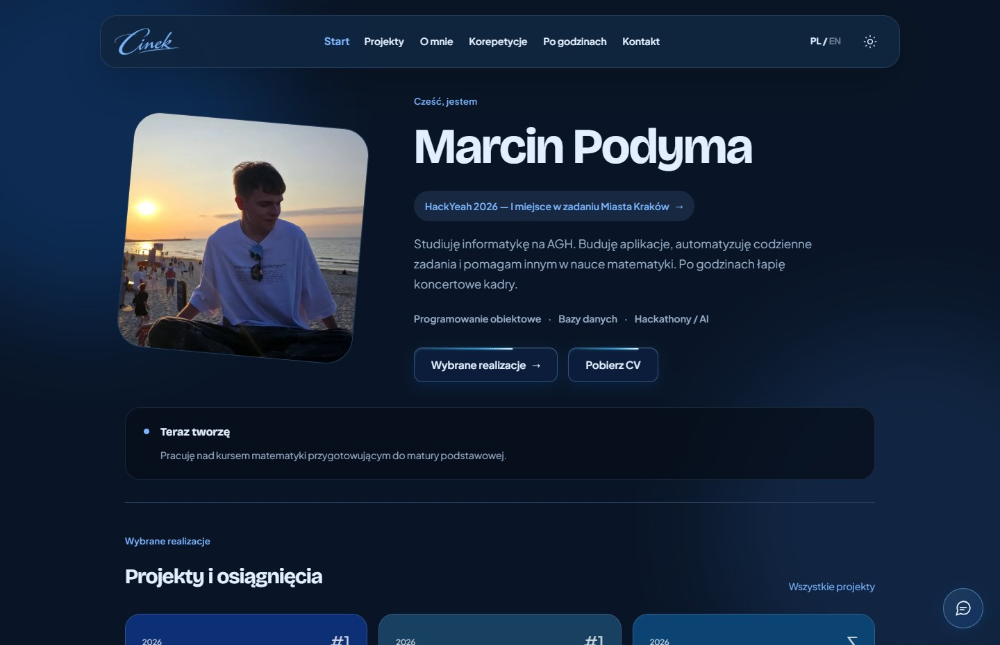

<div align="center">


# Marcin Podyma · Portfolio

**Kod, kadry i trochę matematyki.**

Osobista strona, na której spotykają się projekty programistyczne,<br>
fotografia koncertowa i portretowa oraz korepetycje.

[**Otwórz portfolio ↗**](https://cinek477.github.io/portfolio/) · [Dokumentacja](docs/README.md) · [Uruchomienie](#uruchomienie-lokalne)


</div>

<br>

<table>
  <tr>
    <td width="50%"></td>
    <td width="50%"></td>
  </tr>
  <tr>
    <td align="center"><sub>Jasny motyw</sub></td>
    <td align="center"><sub>Ciemny motyw</sub></td>
  </tr>
</table>

## Nie tylko wizytówka

Portfolio ma dwie części: **publiczną stronę** dla odwiedzających i **lokalny panel**, w którym zarządzam treścią. Bez zewnętrznego CMS-a, bez frameworka frontendowego i bez instalowania pakietów npm.

| Obszar | Co można tu znaleźć |
| :--- | :--- |
| **Projekty** | Realizacje, osiągnięcia, technologie i podstrony opisujące problem, rozwiązanie oraz mój wkład. |
| **Fotografia** | Koncerty, portrety, natura i miejsca. Kategorie, albumy, okładki oraz podgląd pełnych zdjęć. |
| **Korepetycje** | Oferta zajęć, pakiety, opinie uczniów i odpowiedzi na najczęstsze pytania. |
| **Kontakt** | Kreator wiadomości dopasowany do wybranego tematu. |
| **Panel administratora** | Edycja PL/EN, szkice podstron, zarządzanie zdjęciami, opiniami, wiadomościami i kopiami bezpieczeństwa. |

### Galeria z własnym charakterem

- Kadr miniatury ustawiany osobno dla każdego zdjęcia.
- Podgląd w kwadracie, przełączanie na naturalne proporcje i pełny ekran.
- Poświata dopasowana do kolorów fotografii.
- Albumy z wyborem okładki i kopiowaniem bezpośredniego linku.
- Oznaczenia profilu Instagram przy portretach.
- Edytowalny, dekoracyjny napis obok zdjęcia — ustawiany globalnie lub dla pojedynczej fotografii.

Całość uzupełniają **języki PL/EN**, **jasny i ciemny motyw**, obsługa klawiatury oraz ograniczanie animacji zgodnie z ustawieniami systemu.

## Uruchomienie lokalne

Wymagany **Node.js 24+**. SQLite jest wbudowany w Node — krok `npm install` nie jest potrzebny.

```sh
git clone https://github.com/Cinek477/portfolio.git
cd portfolio
npm start
```

| | Adres |
| :--- | :--- |
| Strona | [127.0.0.1:3000](http://127.0.0.1:3000/) |
| Panel administratora | [127.0.0.1:3000/admin](http://127.0.0.1:3000/admin) |

Przy pierwszym wejściu do panelu utwórz konto administratora. Serwer nasłuchuje tylko lokalnie; zatrzymasz go przez **Ctrl+C**.

<details>
<summary><strong>Windows z lokalną kopią Node.js</strong></summary>

Jeżeli runtime znajduje się w `.local/`, uruchom projekt skryptem:

```powershell
powershell -ExecutionPolicy Bypass -File .\scripts\start-gallery.ps1
```

Po zmianach kodu serwera uruchom go ponownie. Nowe pliki strony wystarczy odświeżyć w przeglądarce.

</details>

## Od edycji do publikacji

```text
Panel lokalny → SQLite + publiczne pliki → commit i push → GitHub Actions → GitHub Pages
```

W panelu dodaję treści i fotografie. Zmiany zapisują się w lokalnej bazie, a publiczne dane są eksportowane do plików w `assets/js/`. Zdjęcia trafiają do `assets/images/`.

Po wysłaniu zmian na `main` GitHub Actions uruchamia kontrole i testy, buduje wersję statyczną i publikuje ją na GitHub Pages.

> [!IMPORTANT]
> **Zapis w panelu nie publikuje strony.** Potrzebny jest commit i push. Panel, baza i prywatna skrzynka pozostają na komputerze.

Na GitHub Pages kreator kontaktu otwiera szkic w programie pocztowym — wiadomość wysyła odwiedzający ze swojej poczty. Funkcje wymagające działającego backendu, w tym dane Spotify na żywo, nie są dostępne w wersji statycznej.

[Konfiguracja publikacji →](docs/GITHUB-PAGES.md)

## Dane pod kontrolą

| Publiczne — w repozytorium | Prywatne — poza Git |
| :--- | :--- |
| Kod strony i zasoby | Baza `data/gallery.sqlite` |
| Zdjęcia i miniatury | Konto administratora i wiadomości |
| Eksporty treści oraz ustawień galerii | `.env`, tokeny i kopie bezpieczeństwa |

Panel wymaga logowania, a zapis sprawdza sesję i pochodzenie żądania. Dostępne są kopie ręczne oraz automatyczne przed większymi zmianami.

> [!NOTE]
> Ukrycie zdjęcia lub usunięcie wpisu z galerii **nie usuwa jego pliku z repozytorium**. Fotografie w `assets/` należy traktować jako publiczne.

## Sprawdzanie projektu

```sh
npm run check       # składnia, zasoby, odnośniki i zdjęcia
npm test            # testy na odizolowanych danych
npm run pages:prepare  # lokalny eksport do dist/github-pages/
```

Testy automatyczne uzupełniają, ale nie zastępują sprawdzenia wyglądu i obsługi na komputerze oraz telefonie.

## Mapa repozytorium

```text
pages/          podstrony HTML
assets/         style, skrypty, fotografie i publiczne eksporty
components/     wspólna nawigacja i stopka
shared/         walidacja, treści domyślne i renderowanie
server/         moduły lokalnego backendu
server.cjs      punkt uruchomienia serwera
scripts/        kontrole, uruchamianie i eksport strony
tests/          testy automatyczne
docs/           dokumentacja projektu
data/           prywatna baza SQLite                 [poza Git]
backups/        prywatne kopie bezpieczeństwa          [poza Git]
```

## Dokumentacja

[Panel i zdjęcia](docs/LOCAL-GALLERY.md) · [Galeria i albumy](docs/funkcje/GALERIA-ALBUMY.md) · [Kontakt i poczta](docs/CONTACT-MESSAGES.md) · [GitHub Pages](docs/GITHUB-PAGES.md) · [Zasady wyglądu](docs/DESIGN.md) · [Pełny spis](docs/README.md)

---

<div align="center">

**Marcin Podyma · Cinek**<br>
<sub>Własne projekty. Własne zdjęcia. Własne miejsce w sieci.</sub>

</div>
